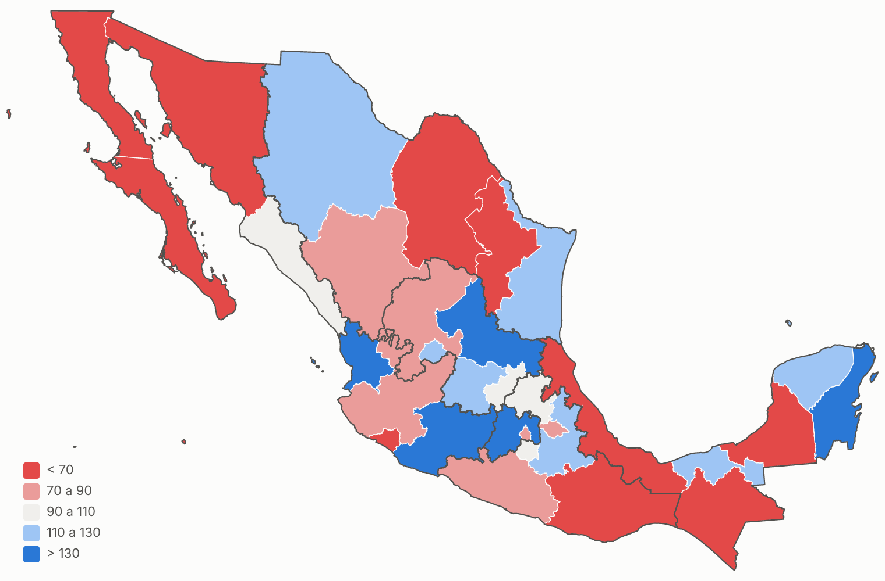
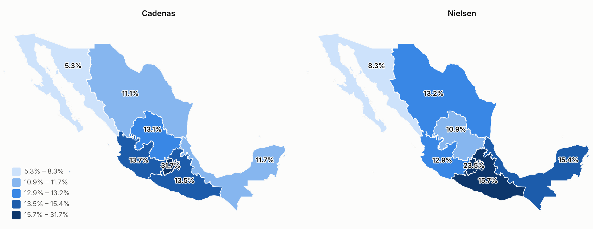

# Mapa de ventas de México para Power BI

Mapas de México por **estado**, **región Nielsen** y **municipio** para Power BI Desktop, hechos con el visual [Deneb](https://deneb-viz.github.io/) (Vega-Lite) y geometría oficial de INEGI. Sirve para ver la venta de una o varias cadenas comerciales y compararla contra el mercado de Nielsen: dónde vende cada quien, dónde hay más intensidad por habitante, dónde crece y dónde hay huecos.

Es un kit general: cada usuario conecta sus propias cadenas relacionando sus tiendas o estados con la clave INEGI, y define sus propias regiones Nielsen.





> Las imágenes usan los **datos ficticios** de la carpeta `ejemplo/`. No representan ninguna cadena ni a Nielsen.

## Qué incluye

| | |
|---|---|
| **Cuatro mapas de Deneb** | Estados con escala automática (quintiles o divergente), bivariado 3×3, comparativo lado a lado Cadenas vs Nielsen por región y municipios (nacional o por estado). |
| **Modelo listo para pegar** | Consultas de Power Query, medidas DAX y un selector de 14 métricas: ventas, % de la venta nacional, intensidad per cápita, índice contra Nielsen, brechas, crecimiento y precio. |
| **Geometría INEGI** | 32 estados, 2,475 municipios y regiones, simplificados para que el mapa cargue rápido (estados: 75 KB). |
| **Catálogos** | Claves INEGI, abreviaturas, códigos ISO, población del Censo 2020 y más de 100 formas de escribir los estados ("Edo. de México", "CDMX", "Nuevo Leon"…). |
| **Datos de ejemplo** | Tres cadenas ficticias con formatos distintos (por tienda, por nombre de estado y por clave municipal) y una extracción ficticia de Nielsen. |
| **Scripts** | Regenerar geometría y regiones, validar la configuración y volver a dibujar las vistas previas. |


## Cómo funciona

```
Archivos de cada cadena ──► Power Query ──► Fact_Cadenas (CVEGEO, UPC, fecha, venta)
   tienda / estado / clave      │  mapeo de ubicaciones + alias de estados
                                ▼
Extracción Nielsen ─────────► Fact_Nielsen (región, UPC, periodo, venta)

Dim_Region ◄── Dim_Geo ◄── Dim_Municipio ◄── Fact_Cadenas
    ▲
    └──────── Fact_Nielsen

Selector de métrica ──► [Valor Mapa] + [Config Mapa] ──► Deneb (TopoJSON incrustado)
```

- **Cadenas y Nielsen son fuentes independientes.** La comparación se hace por *distribución geográfica*: qué parte de la venta nacional cae en cada estado o región en cada fuente.
- Nielsen llega por región. A nivel estado se puede ver la región completa o una **estimación por población** que, sumada por región, devuelve el dato original.
- Deneb recibe solo una fila por estado (o municipio), aunque el modelo tenga millones de filas. Clases, colores y leyenda se calculan dentro del visual.

## Inicio rápido

1. Descarga o clona el repositorio en tu PC.
2. En Power BI Desktop instala **Deneb** desde AppSource (Insertar › Más objetos visuales › Desde AppSource).
3. Sigue **[docs/01-armado-paso-a-paso.md](docs/01-armado-paso-a-paso.md)**: pegar las consultas de `powerquery/`, crear relaciones, cargar `dax/medidas.dax` y poner el visual con `deneb/mapa_estados.json`.
4. Comprueba tus números contra [docs/valores_esperados_ejemplo.csv](docs/valores_esperados_ejemplo.csv).
5. Cambia los datos de ejemplo por los tuyos con **[docs/03-adaptar-a-tu-proyecto.md](docs/03-adaptar-a-tu-proyecto.md)**.

No hace falta Node ni Python para usar el kit; solo para regenerar geometría, regiones o vistas previas.

## Documentación

| Guía | Contenido |
|---|---|
| [01 · Armado paso a paso](docs/01-armado-paso-a-paso.md) | Power Query, relaciones, medidas y primer mapa. |
| [02 · Mapas con Deneb](docs/02-mapas-deneb.md) | Los cuatro mapas, campos que espera cada uno, colores y escalas. |
| [03 · Adaptar a tu proyecto](docs/03-adaptar-a-tu-proyecto.md) | Agregar cadenas, mapear tiendas, definir regiones Nielsen, productos, periodos y métricas nuevas. |
| [04 · Municipios y rendimiento](docs/04-municipios-y-rendimiento.md) | Nivel municipal y recomendaciones para millones de filas. |

## Estructura

```
config/        Lo que editas: estados, regiones Nielsen, alias, mapeo de ubicaciones
catalogos/     Generado: dim_geo, dim_municipio, dim_region
geo/           Generado: TopoJSON y GeoJSON de estados, regiones y municipios
deneb/         Generado: especificaciones Vega-Lite listas para pegar en Deneb
powerquery/    Consultas M (una por bloque)
dax/           Medidas y tabla calendario
ejemplo/       Datos ficticios de tres cadenas y Nielsen
scripts/       Construcción de geometría, especificaciones, validación y vistas previas
docs/          Guías, imágenes y valores esperados
powerbi/       Aquí puedes guardar tu reporte como proyecto .pbip
```

## Regenerar geometría y regiones

Necesitas Node 20 o superior.

```bash
npm install
npm run geo                                  # tras editar config/regiones_*.csv
npm run geo -- --fuente "C:/INEGI/00mun.shp" # desde la capa original de INEGI
python scripts/validar.py                    # revisa que todo coincida
```

`npm run geo` reconstruye estados, regiones, municipios, catálogos y las especificaciones de Deneb (que llevan la geometría dentro). Para vistas previas: `pip install -r requirements.txt`, `python scripts/modelo_referencia.py` y `npm run vistas`.

## Fuentes y licencia

- Límites municipales y estatales: Marco Geoestadístico, **INEGI**. Población: Censo de Población y Vivienda 2020, **INEGI**. Detalle en [ATRIBUCION.md](ATRIBUCION.md).
- Código y documentación: [MIT](LICENSE).
- Nielsen es marca de NielsenIQ. Este proyecto no está afiliado a NielsenIQ ni a ninguna cadena comercial.

¿Mejoras o dudas? Abre un *issue* o revisa [CONTRIBUTING.md](CONTRIBUTING.md).
