# 01 · Usar el visual

## Instalarlo

- **En un reporte**: panel *Visualizaciones* › *…* › *Importar un objeto visual desde un archivo* y elige el `.pbiviz`.
- **Para toda la organización**: un administrador lo sube en *Portal de administración › Objetos visuales de la organización*. Así todos usan la misma versión revisada y las actualizaciones se controlan en un solo lugar.

Descarga el archivo del *release* de GitHub y comprueba su huella antes de instalarlo ([SECURITY.md](../SECURITY.md)).

## Campos

| Campo | Qué poner | |
|---|---|---|
| **Ubicación (clave INEGI)** | La clave del estado (`CVE_ENT`, 2 dígitos) o del municipio (`CVEGEO`, 5 dígitos). Admite una jerarquía estado → municipio. | obligatorio |
| **Región** | Una columna con la región de cada área. Las regiones **las defines tú** en tu modelo: zonas comerciales, territorios de venta… (ver [Regiones](#regiones)). | opcional |
| **Valor** | La medida que colorea el mapa. Cualquiera de tu modelo. | obligatorio |
| **Valor 2 (bivariado)** | Una segunda medida: el mapa pasa a ser bivariado. | opcional |
| **Bases a comparar** | Hasta 4 medidas, una por fuente (por ejemplo `Ventas Cadenas` y `Ventas Mercado Estimada`). El [panel de detalle](#panel-de-detalle) las compara contra la primera. Sin Valor, el mapa se colorea con la primera base. | opcional |
| **Tarjetas** | Hasta 8 medidas DAX que el panel de detalle muestra como tarjetas. | opcional |
| **Información sobre herramientas** | Medidas extra que aparecen al pasar el cursor. | opcional |

La clave puede ser texto o número: el visual completa los ceros que Excel o Power BI suelen quitar (`9` → `"09"`, `1002` → `"01002"`). Los nombres no sirven en Ubicación; si tus datos solo traen nombres o tiendas, conviértelos a clave con el [puente INEGI](02-puente-inegi.md).

**Recomendado:** relaciona tus hechos con dimensiones de estados y municipios (por ejemplo `Dim_Geo` y `Dim_Municipio` del puente) y usa sus claves. Así las segmentaciones y el drill-down funcionan como en cualquier visual. Una columna de clave de cualquier otra tabla también sirve.

## Estados y municipios

El visual decide el nivel por la clave: con `CVE_ENT` dibuja los 32 estados; con `CVEGEO`, los municipios.

- En el nivel municipal dibuja **solo los municipios de los estados que traen datos**, con los límites estatales como referencia; los demás estados quedan de fondo, en gris. Si filtras la página a Jalisco, el mapa se acerca a Jalisco; sin filtro, ves los 2,475 municipios.
- Las claves `XX000` (datos que solo llegan a nivel estatal, como las del puente) no se dibujan en el nivel municipal: el visual las cuenta en el aviso.

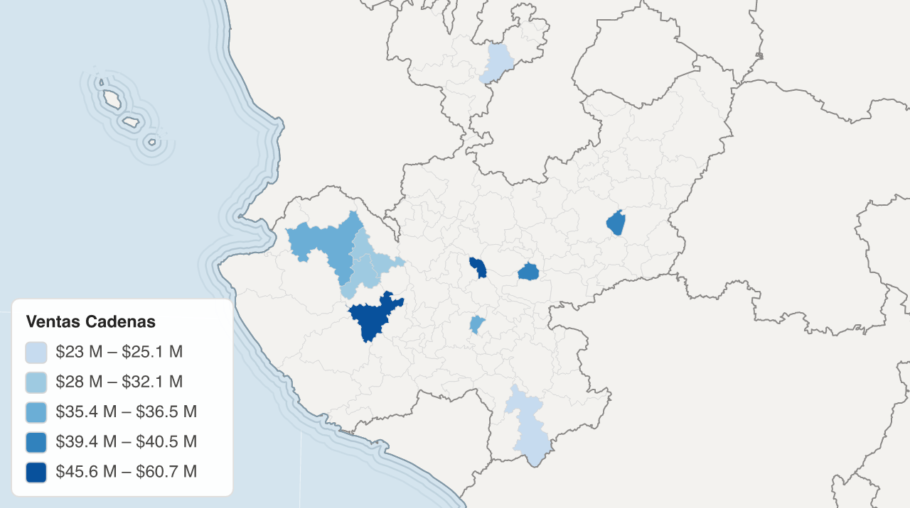

### Drill-down

Pon en Ubicación las dos columnas, en este orden: `Dim_Geo[CVE_ENT]` y debajo `Dim_Municipio[CVEGEO]`. Aparecen las flechas de exploración en el encabezado del visual:

- **Activar exploración** y clic en un estado: baja a sus municipios y el mapa se acerca.
- **Expandir todo un nivel**: municipios de todo el país.
- **Subir un nivel**: vuelve a estados.

Siempre se dibuja el nivel más profundo que manda Power BI.

## Fondo: el mar y los países vecinos

Alrededor de México se dibuja el mar, con **líneas de agua** que siguen la costa y una retícula tenue de meridianos y paralelos. También aparecen los países vecinos con sus fronteras, y los nombres de los mares (en cursiva, como en los mapas impresos) y de los países: *Océano Pacífico*, *Golfo de México*, *Golfo de California*, *Mar Caribe*, *Estados Unidos*, *Guatemala*, *Belice*… Cada nombre va donde cabe completo, sin caer en tierra ni tapar la leyenda u otras etiquetas. Al acercarte, se recolocan.

En *Formato › Mapa* eliges el **color del mar** y el **de los países vecinos**, y puedes apagar los **nombres de mares y países**. Con **Fondo › Sin fondo** se dibuja solo México sobre el fondo del reporte, como antes de la versión 0.5. En alto contraste, el visual siempre va sin fondo.

La tierra de los países vecinos viene de [Natural Earth](https://www.naturalearthdata.com/) (dominio público) y va dentro del visual, como la geometría de INEGI: el visual sigue sin conectarse a internet.

## Regiones

Las regiones **no vienen en el visual**: son un dato de tu modelo, así que cada quien usa las suyas (zonas comerciales, territorios de venta, las de su proveedor de datos) y las cambia cuando quiera.

### Define tus regiones

1. Haz una tabla con dos columnas: la clave del área y su región. Por estado, `CVE_ENT → REGION` (32 filas); por municipio, `CVEGEO → REGION`, si tus territorios parten estados. El ejemplo trae una en [`ejemplo/config/regiones_estado.csv`](../ejemplo/config/regiones_estado.csv): cópiala y cambia los nombres.
2. Agrégala como columna a tu dimensión de estados (o de municipios) al combinarla en Power Query, como hace [`ejemplo/powerquery/04_Dimensiones.pq`](../ejemplo/powerquery/04_Dimensiones.pq). Así sirve también en segmentaciones y en otros visuales.
3. Pon esa columna en el campo **Región** del visual (por ejemplo `Dim_Geo[REGION]`).

### Qué hace el visual con ellas

- Dibuja el **contorno de cada región** donde cambia de valor, calculado con los datos de ese momento: si cambias las regiones en tu modelo, el mapa cambia solo, sin regenerar geometría. Un halo claro bajo el contorno lo separa también sobre los colores oscuros. Con el mar de fondo, la costa la marca su propia línea y el contorno solo separa regiones.
- Escribe el **nombre de cada región** sobre el mapa. Un clic en el nombre selecciona la región entera y abre el panel de detalle con sus totales.
- Funciona también en municipios: una región puede partir un estado (una zona metropolitana que cruza estados, territorios de venta por municipio).
- Agrega la región al tooltip.
- Si filtras una región (con una segmentación sobre tu columna de región), el mapa la muestra en grande con su panel: ver [Filtros, segmentaciones y otros visuales](#filtros-segmentaciones-y-otros-visuales).

Para distinguir mejor las regiones, en *Regiones › Colores de las regiones* elige **Franja de color por región**: cada región lleva una franja de su color por dentro del contorno, con los colores del tema del reporte, y la leyenda suma la lista de regiones (un clic en una la selecciona). O, en *Colores › Colorear por*, elige **Región** para pintar cada región de un color, sin medida.

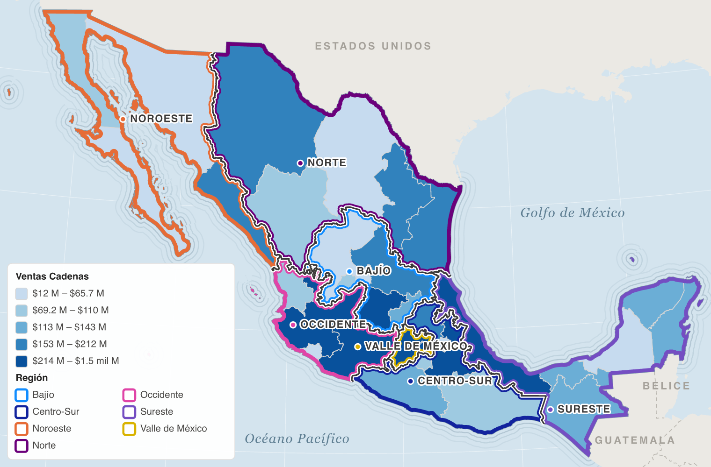

Para un **mapa de regiones**, usa una medida que devuelva el valor de la región en cada estado, por ejemplo `CALCULATE ( [Tu medida], ALLEXCEPT ( Dim_Geo, Dim_Geo[REGION] ) )`, y apaga *Regiones › Límites dentro de cada región*: cada región se ve como una sola área.

La región debe ser un atributo del área: un solo valor por estado o municipio. Si una clave llega con dos regiones distintas, el visual la reporta como repetida.

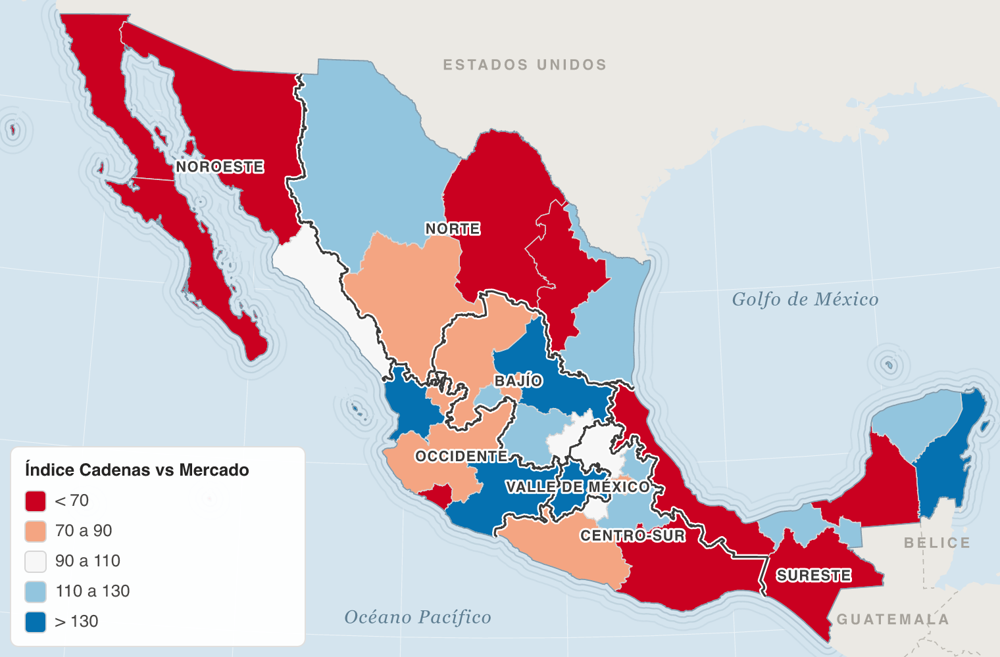

## Mapa bivariado

Con una medida en **Valor 2**, cada medida se parte en terciles (bajo, medio, alto) y cada área toma el color de la combinación: Valor crece hacia la derecha de la leyenda y Valor 2 hacia arriba. La esquina oscura es "alto en ambas".

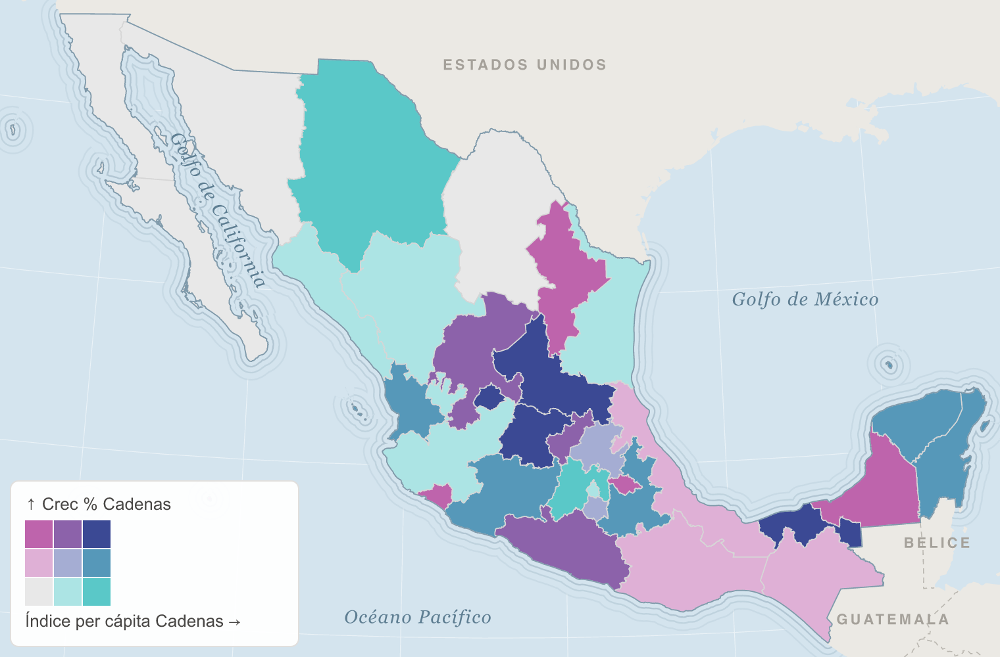

| Valor | Valor 2 | Pregunta |
|---|---|---|
| Índice per cápita | Crecimiento | ¿Dónde somos fuertes y además crecemos? |
| Índice contra el mercado | Brecha de crecimiento | ¿Dónde estamos sub-representados y perdiendo terreno? |
| % de la venta nacional | Índice de precio | ¿Los estados que más pesan son los más caros? |

En el bivariado no aplican el método ni las clases de la tarjeta Colores; la paleta se elige en la tarjeta **Bivariado**. El tooltip muestra las dos medidas y la clase ("alto en Índice · bajo en Crecimiento").

## Filtros, segmentaciones y otros visuales

### El mapa se acerca a lo que dejas

Cuando un filtro, una segmentación o un drill-down dejan solo una parte del país (una región, unos estados, un estado), el mapa **se acerca a esa parte** y la muestra en grande. Las áreas que quedaron fuera se dibujan de fondo, en el color *Fuera del filtro* (gris muy claro), para que se vea dónde está lo que miras. Al quitar el filtro, vuelve al país completo con una transición corta.

- El botón ⛶ (*Vista inicial*) y la tecla `0` vuelven a ese encuadre; con `−` puedes alejarte hasta ver el país.
- *Formato › Mapa › Encuadre › Todo el país* lo apaga: el mapa no se acerca solo (en municipios encuadra los estados que se dibujan, como siempre).

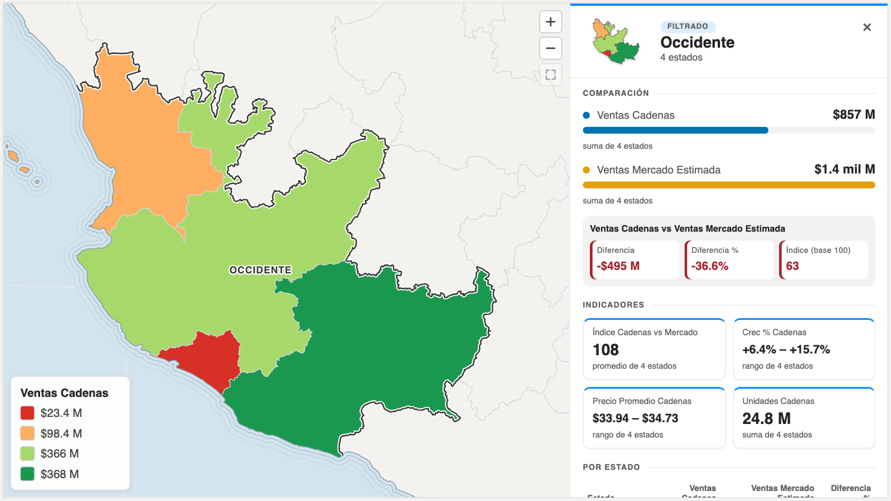

### El panel se abre solo

Con *Panel de detalle › Abrir el panel › Al seleccionar o filtrar* (la opción por omisión), el panel también se abre cuando el mapa muestra una parte del país, y resume lo que quedó. Si quedan regiones completas, el título es su nombre (*Occidente*). Si queda un estado, o un estado con sus municipios, es el nombre del estado. Una etiqueta arriba del título dice por qué está abierto: **Filtrado**, **Selección** o **Desde otro visual**.

- Con un filtro activo, un clic en un estado muestra ese estado; su botón × quita la selección y regresa al resumen del filtro.
- Sin selección, el × **oculta** el panel hasta que cambien los datos (otro filtro).
- **Al seleccionar**: el panel solo se abre con un clic en el mapa. **Siempre**: resume todas las áreas con datos, haya filtro o no (es la opción que antes se llamaba *Mostrar sin selección*).

¿Cuándo es "una parte del país"? Cuando quedan con datos el 60 % de los estados o menos, o más pero juntos (una región grande). En municipios cuenta cuántos estados hay: un drill-down a un estado sí lo es; una cadena con tiendas en municipios de todo el país, no.

### Un clic en otro visual

Si haces clic en otro visual de la página (una fila de una tabla, una barra), Power BI **resalta** en el mapa la parte que corresponde:

- El mapa usa los **valores resaltados**: colores, leyenda, tooltip y panel. Si la fila es un producto, ves la venta de ese producto por estado.
- Lo que no corresponde queda de fondo. Si lo resaltado es una parte del país (la fila es una región o un estado), el mapa se acerca a ella.
- El panel se abre con la etiqueta **Desde otro visual** y resume lo resaltado.

Si prefieres que el otro visual **filtre** el mapa en lugar de resaltarlo (*Formato › Editar interacciones*, el ícono de filtro sobre el mapa), el mapa recibe los datos ya filtrados y se comporta como con una segmentación.

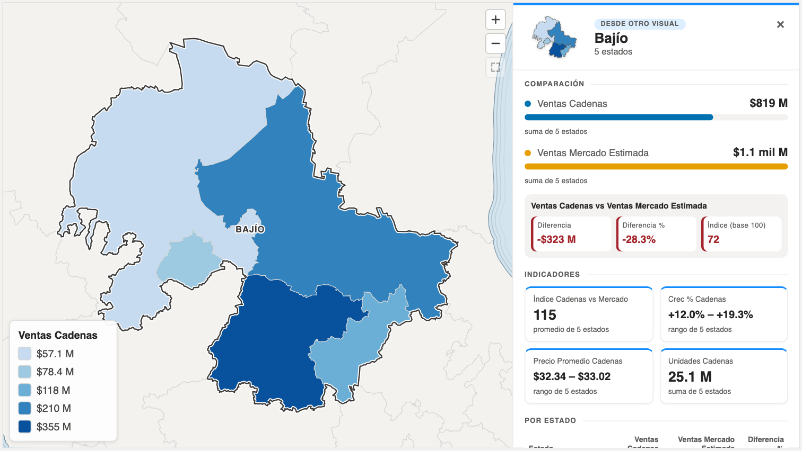

## Panel de detalle

Al hacer clic en un estado (o en varios, con Ctrl+clic; en Mac, ⌘+clic), al filtrar una parte del país o al hacer clic en otro visual, se abre un panel junto al mapa con:

- La **silueta** de lo que resume, con sus colores del mapa; su nombre (o "3 estados", o el nombre de la región si está completa) y por qué está abierto. La franja de arriba toma el color de la región.
- **Comparación** de las *Bases a comparar*: el valor de cada una con una barra proporcional y, de la primera contra cada una de las demás, la **diferencia**, la **diferencia %** y el **índice** (base 100), en verde o rojo según el signo. Entre dos porcentajes (por ejemplo `% Mix Cadenas` y `% Mix Mercado`) la diferencia va en puntos porcentuales.
- **Indicadores**: una tarjeta por cada medida de *Tarjetas* (sin tarjetas, muestra Valor).
- Con varias áreas, una **tabla por estado** (o municipio) ordenada de mayor a menor, con una barra en la primera cifra. **Un clic en una fila** selecciona esa área en el mapa; al pasar el cursor por una fila, el área se marca en el mapa.

Con una selección, el botón ×, un clic en el fondo del mapa o Esc la quitan. Para seleccionar una región completa, haz clic en su nombre sobre el mapa o en la leyenda.

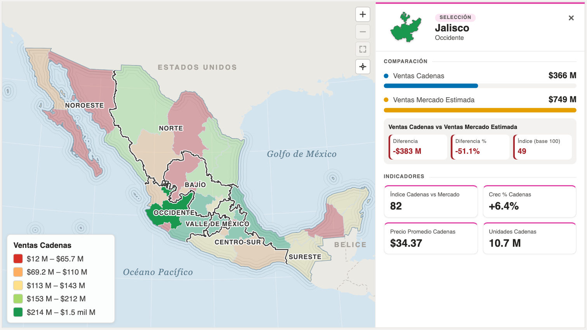

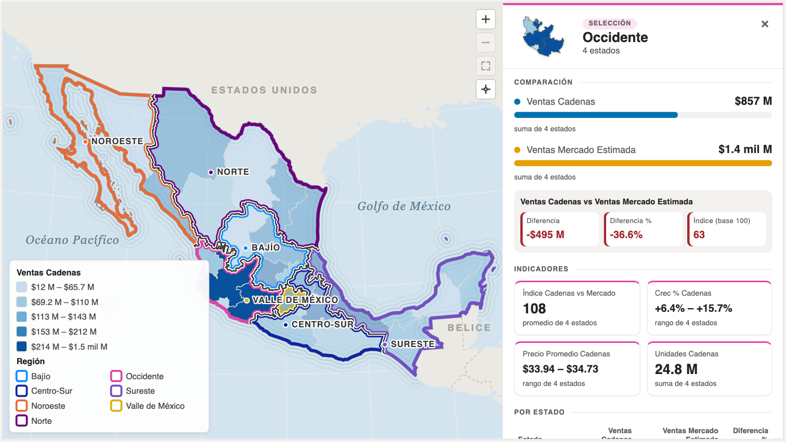

### Varias áreas: cómo se combina cada medida

El visual recibe de Power BI un valor por estado y no sabe si tu medida se puede sumar. Por eso, en *Formato › Al seleccionar varias áreas* hay una lista por medida para elegir cómo se combina:

| Opción | Úsala para |
|---|---|
| **Suma** | Medidas aditivas: ventas, unidades, % de mix. Es lo que usan las bases si no eliges otra cosa. |
| **Promedio**, **Mínimo**, **Máximo** | Índices, precios, crecimientos (un promedio simple, sin ponderar). |
| **Rango (sin combinar)** | Muestra del mínimo al máximo. Es lo que usan las tarjetas si no eliges otra cosa. |

La diferencia, la diferencia % y el índice de la comparación se calculan con los totales de las bases, así que son correctos para cualquier selección si las bases son aditivas. No pongas como base una medida que repite el total de la región en cada estado (en el ejemplo, `[Ventas Mercado]`): usa la versión que reparte la región (`[Ventas Mercado Estimada]`).

Si necesitas el valor exacto de una medida no aditiva para varios estados, calcúlalo en DAX y muéstralo con un objeto visual de tarjeta de Power BI, que sí responde al filtro del mapa.

### Dónde aparece

*Formato › Panel de detalle › Posición*: **Automática** (a la derecha en un visual ancho, abajo en uno alto y flotando encima en uno chico), **A la derecha**, **Abajo** o **Flotando sobre el mapa**. *Tamaño* es la parte del visual que ocupa. *Abrir el panel* decide cuándo aparece solo (ver [arriba](#el-panel-se-abre-solo)). El *Modo de enfoque* de Power BI (en el encabezado del visual) le da más espacio a todo.

## Zoom

- **Rueda del ratón** (o pellizco en el trackpad): acerca alrededor del cursor. En *Formato › Zoom › Rueda del ratón* elige *Acerca con Ctrl* si tu página se desplaza y no quieres que la rueda la detenga, o *Nunca acerca* para usar solo los botones. En la vista completa, girar la rueda hacia atrás sigue desplazando la página.
- **Arrastrar** mueve el mapa; en pantallas táctiles, pellizca para acercar. Un arrastre no selecciona ni quita la selección.
- **Botones**: acercar, alejar, volver a la vista inicial (el encuadre de los datos; sin filtro, el país completo) y, con una selección, acercar a ella.
- **Teclado**: `+` y `-` acercan y alejan, `0` vuelve a la vista inicial y Esc quita la selección.
- **Acercar a la selección** (opción del formato): al seleccionar, el mapa se acerca solo; al quitar la selección, vuelve a la vista inicial. Las islas lejanas (Revillagigedo, Islas Marías) no cuentan para el encuadre.

Al acercarte aparecen las etiquetas de las áreas chicas, y las líneas conservan su grosor. Si el panel de detalle se abre con el mapa acercado, se conserva el centro y la escala.

## Comparar fuentes en el mapa

Con dos bases o más, *Colores › Colorear por* ofrece **Diferencia entre bases** (primera menos segunda, con el formato de la primera) y **Diferencia % entre bases** ((primera − segunda) / segunda). Las dos se pintan con escala divergente alrededor de 0: ajusta los umbrales de "similar" y de "muy" (por ejemplo `0.1` y `0.3` para ±10 % y ±30 %). Es la pregunta "¿dónde se separan más las dos fuentes?" sin escribir otra medida.

## Etiquetas

*Formato › Etiquetas* muestra sobre cada área el valor (abreviado: `$212 M`), el nombre o ambos. Solo se dibujan donde caben y sin encimarse: las áreas grandes ponen su etiqueta primero. Con el mapa más grande o el texto más chico aparecen más.

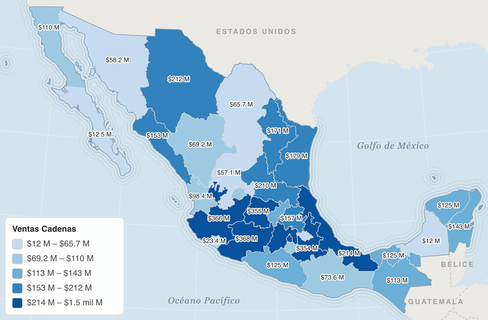

## Panel de formato

**Colores**

| Opción | Para qué |
|---|---|
| Método | *Cuantiles*: el mismo número de áreas por clase, bueno para magnitudes (ventas, unidades). *Intervalos iguales*: clases del mismo ancho. *Divergente*: cinco clases alrededor de un centro. |
| Número de clases | 2 a 7 (cuantiles e intervalos). |
| Colorear por | *Valor*, *Diferencia entre bases*, *Diferencia % entre bases* o *Región* (aparece si hay dos bases o una región). |
| Paleta | Secuenciales de un tono o divergentes de dos tonos (ColorBrewer, aptas para daltonismo), y el **semáforo** (rojo · amarillo · verde), secuencial o divergente. |
| Centro | Valor neutro de la escala divergente, en las unidades de la medida: `100` para un índice, `0` para crecimientos o brechas. |
| Umbral de "similar" / de "muy" | Distancia al centro que separa las clases. Con centro 100, umbrales `10` y `30` dan: < 70, 70 a 90, 90 a 110, 110 a 130, > 130. Para crecimientos en %, `0.02` y `0.08` son ±2 % y ±8 %. En `0` se calculan solos. |
| Invertir colores | Útil cuando un valor alto es malo (precio, quiebres). |
| Sin dato | Color de las áreas sin valor. |
| Fuera del filtro | Color de las áreas que quedan de fondo cuando el mapa muestra una parte del país. |

**Mapa:** proyección (Lambert, la que usa INEGI, o Mercator), encuadre (ajustar a los datos o todo el país), fondo (mar y países vecinos, o sin fondo), color del mar y de los países vecinos, nombres de mares y países, y color y grosor de los límites. En municipios los límites se dibujan a la mitad de grosor.

**Bivariado** (aparece al usar Valor 2): paleta de 3×3.

**Regiones** (aparece al usar el campo Región): mostrar el contorno, colores de las regiones (solo contorno o franja de color por región), color y grosor del contorno, mostrar u ocultar los límites dentro de cada región, y el nombre de cada región con su tamaño.

**Etiquetas:** mostrar, contenido (valor, nombre o ambos), tamaño y color del texto.

**Leyenda:** mostrar u ocultar, estilo, posición, título (por defecto, el nombre de la medida) y tamaño del texto (13 por omisión). Estilo **Lista**: una fila por clase. Estilo **Barra**: una barra de colores con los cortes debajo, más compacta. En un visual chico o con muchas regiones, la leyenda se reduce sola (hasta 9 px de texto) para no tapar el mapa, y las etiquetas del mapa no se escriben debajo de ella. Las cifras usan el formato de tu medida, abreviadas en español: `$78.4 M`, `$1.5 mil M`.

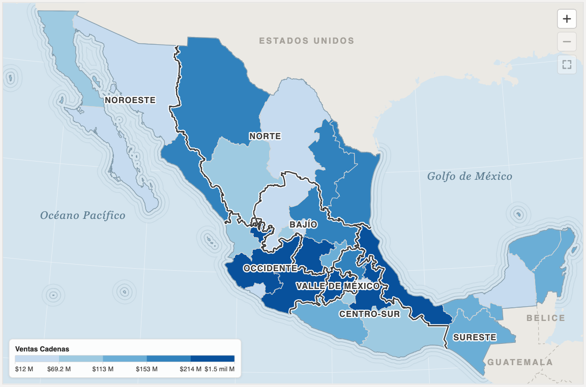

**Panel de detalle:** mostrar, cuándo abrirlo, posición, tamaño, silueta, diferencia, índice, diferencias en verde y rojo, y tamaño del texto.

**Al seleccionar varias áreas:** cómo se combina cada medida del panel (ver [arriba](#varias-áreas-cómo-se-combina-cada-medida)).

**Zoom:** permitir zoom, rueda del ratón, botones y su posición, y acercar a la selección.

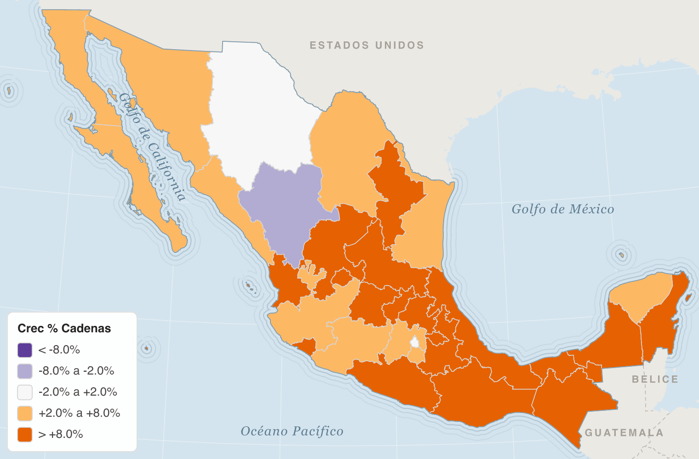

### Semáforo

La paleta **Semáforo** va de rojo (valor bajo) a verde (valor alto), con amarillo al centro: pensada para el mapa de ventas. *Invertir colores* la voltea para medidas donde lo alto es malo (precio, quiebres). En la escala divergente pinta rojo muy por debajo, amarillo similar y verde muy por encima: útil para índices (centro 100) y crecimientos (centro 0).

Rojo y verde se confunden con el daltonismo más común (alrededor de 1 de cada 12 hombres). El amarillo del centro y la diferencia de claridad ayudan, pero si el reporte lo verá mucha gente, acompáñalo de etiquetas o usa una paleta de un solo tono.

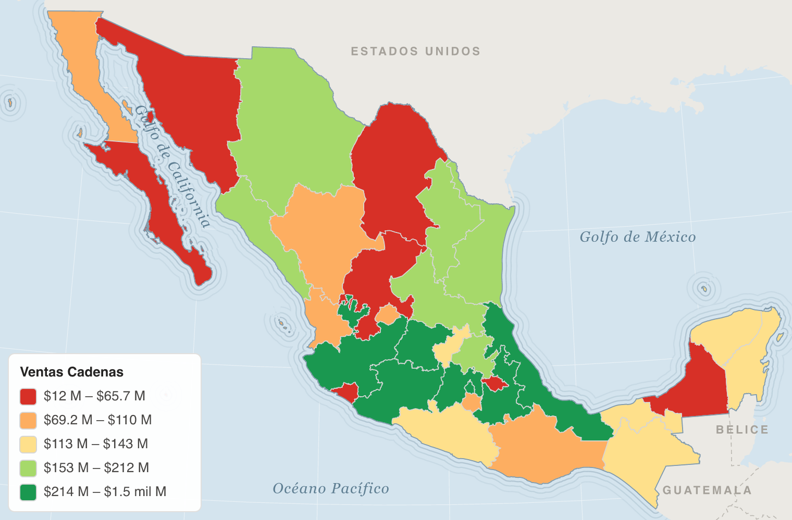

## Cambiar de métrica

Crea un **parámetro de campo** (*Modelado › Nuevo parámetro › Campos*) con tus medidas, ponlo en *Valor* y agrega su segmentación. El visual lee el campo por su papel (Valor), no por su nombre, así que el cambio es inmediato.

Si unas métricas necesitan escala divergente y otras no, usa un visual por tipo o cambia el método en el panel.

## Interacción

- **Clic** en un área: filtra el resto de la página y abre el panel de detalle. **Ctrl+clic** (⌘+clic en Mac) agrega áreas. **Clic en el fondo** o Esc: quita la selección.
- **Clic en el nombre de una región** (sobre el mapa o en la leyenda): selecciona la región entera.
- **Clic en una fila de la tabla del panel**: selecciona esa área.
- **Zoom**: rueda, arrastre, pellizco, botones y teclado (ver [Zoom](#zoom)).
- **Clic en otro visual** (una barra, una fila): el mapa usa los valores resaltados, deja de fondo lo que no corresponde y abre el panel (ver [Un clic en otro visual](#un-clic-en-otro-visual)).
- **Clic derecho**: menú contextual de Power BI (obtener detalles, incluir, excluir, explorar…).
- **Teclado**: *Tab* recorre las áreas con datos; *Enter* o *Espacio* selecciona.
- **Tooltips**: área (y estado, en municipios), región, valor con su formato, las bases y su diferencia, y las medidas extra. También admite tooltips de página.

## Idiomas

Los textos del visual (campos, panel de formato, tooltips, leyenda y avisos) salen en **español** si Power BI está en español y en **inglés** en cualquier otro idioma. Las cifras siguen la configuración regional del reporte.

## Avisos del visual

Cuando hay un problema con las claves, el visual lo escribe en una esquina del mapa y además muestra el **ícono de advertencia** en su encabezado, con el detalle.

| Aviso o mensaje | Qué significa |
|---|---|
| ⚠ *N claves no reconocidas* | Hay valores en Ubicación que no son una clave INEGI (nombres, `33`, vacíos…). Pasa el cursor sobre el aviso para ver cuáles. Un *(en blanco)* suele indicar hechos que no encontraron su área en la relación. |
| ⚠ *N de otro nivel* | Llegaron claves de estado y de municipio mezcladas: se dibuja el nivel de la mayoría. |
| ⚠ *N sin municipio* | Claves `XX000`: datos que solo llegan a nivel estatal y no se pueden dibujar por municipio. |
| ⚠ *N repetidas* | La misma clave llega dos veces, por ejemplo `"9"` y `"09"`, o con dos regiones. Se usa la primera. |
| *Ubicación necesita claves INEGI…* | Pusiste nombres (de estado o de región) en Ubicación. Las regiones van en el campo Región. |
| *Agrega una medida en Valor* | Falta la medida. |

## Problemas comunes

| Síntoma | Causa probable |
|---|---|
| Todo el mapa en "Sin dato" | La columna de Ubicación no trae claves (revisa el aviso) o la medida da vacío con los filtros actuales. |
| Un área sale sin dato y no debería | En tu modelo, sus hechos no se relacionan con su clave. Revisa la relación o el control de ubicaciones del puente. |
| Todas las áreas del mismo color | Los valores son iguales, o la escala divergente tiene umbrales muy grandes para las unidades de la medida. |
| La leyenda muestra porcentajes como 0.25 | La medida no tiene formato de porcentaje. Dale formato en el modelo. |
| No aparecen las flechas de drill-down | Ubicación tiene una sola columna. Agrega la de municipio debajo de la de estado. |
| El mapa se acerca y abre el panel sin que yo filtre nada | Tus datos cubren pocas áreas (una cadena con presencia en 10 estados): el visual lo toma como una parte del país. Usa *Mapa › Encuadre › Todo el país* y *Panel de detalle › Abrir el panel › Al seleccionar*. |
| Quiero el fondo de mi reporte, no el mar | *Mapa › Fondo › Sin fondo*. |
