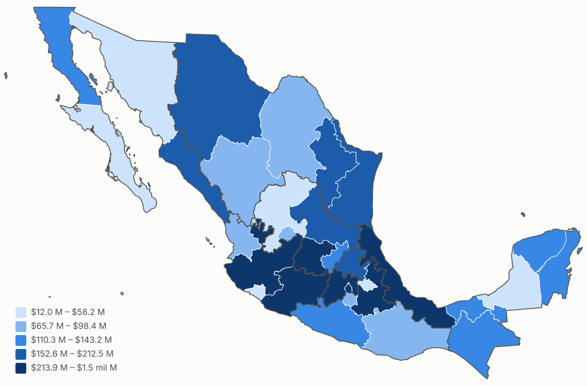

# 02 · Mapas con Deneb

Deneb es un visual certificado de Power BI que dibuja especificaciones de Vega-Lite. Al ser certificado no puede descargar archivos, por eso **cada especificación lleva la geometría incrustada** (sección `datasets`). Si cambias regiones o geometría, `npm run geo` regenera las especificaciones.

Todas reciben los datos en `dataset`, filtran filas sin valor y calculan clases, colores y leyenda dentro del visual. Power BI solo envía una fila por estado, región o municipio, así que el mapa responde igual de rápido con mil filas que con diez millones en el modelo.

## Los cuatro mapas

### `deneb/mapa_estados.json` — mapa principal

| Campo en Deneb | Origen |
|---|---|
| `CVE_ENT` | `Dim_Geo[CVE_ENT]` (texto, "01"–"32") |
| `ESTADO` | `Dim_Geo[ESTADO]` |
| `REGION_NIELSEN` | `Dim_Geo[REGION_NIELSEN]` |
| `Valor Mapa` | medida |
| `Valor Mapa Texto` | medida |
| `Config Mapa` | medida |

- Proyección cónica conforme de Lambert (paralelos 17.5° y 29.5°, la misma que usa INEGI).
- Estados sin dato en blanco con borde gris; contorno de regiones Nielsen encima.
- Tooltip: estado, región, métrica, valor, rango y lugar ("3 de 32").



### `deneb/mapa_bivariado.json` — dos métricas a la vez

Mismos campos que el principal más `Valor Mapa 2`, `Valor Mapa 2 Texto` y `Config Mapa 2`. Agrega un segundo selector con `Selector Métrica 2[METRICA]`.

Cada métrica se parte en terciles: **X en azul verdoso, Y en rosa, alto-alto en índigo**. La leyenda 3×3 se dibuja abajo a la izquierda con los nombres de ambas métricas.

Combinaciones útiles:

| X | Y | Pregunta |
|---|---|---|
| Índice per cápita | Crecimiento | ¿Dónde somos fuertes y además crecemos? |
| Índice vs Nielsen | Brecha de crecimiento | ¿Dónde estamos sub-representados y perdiendo terreno? |
| % de la venta nacional | Índice de precio | ¿Los estados que más pesan son los más caros? |

### `deneb/comparativo_regiones.json` — Cadenas vs Nielsen lado a lado

| Campo en Deneb | Origen |
|---|---|
| `REGION_NIELSEN` | `Dim_Region[REGION_NIELSEN]` |
| `Comparar Cadenas` | medida |
| `Comparar Cadenas Texto` | medida |
| `Comparar Nielsen` | medida |
| `Comparar Nielsen Texto` | medida |
| `Config Comparación` | medida |

Dibuja dos copias del mapa de regiones en una sola vista, con **la misma escala de color** para ambas fuentes y el valor escrito en cada región. Se controla con `Selector Comparación[COMPARACION]`: distribución (% del total), intensidad per cápita, crecimiento o precio.

Usa proyección Mercator porque permite desplazar la segunda copia sin deformarla.

### `deneb/municipios/` — nivel municipal

Ver [guía 04](04-municipios-y-rendimiento.md).

## Cómo se decide el color

La medida `[Config Mapa]` le pasa a Deneb una línea como esta:

```
divergente|100|10|30|< 70|70 a 90|90 a 110|110 a 130|> 130|Índice Cadenas vs Nielsen (100 = misma distribución)
escala    |centro|umbral1|umbral2| 5 etiquetas de la leyenda                 | título
```

Sale de las columnas de `Selector Métrica`, así que **cambiar escalas no requiere tocar Deneb**:

| `ESCALA` | Cómo colorea | Cuándo usarla |
|---|---|---|
| `secuencial` | 5 quintiles (mismo número de estados por clase), azul claro → azul oscuro. La leyenda muestra el rango real de cada clase. | Magnitudes: ventas, unidades, mix, precio. |
| `divergente` | 5 clases fijas alrededor de `CENTRO`: rojo (muy por debajo), rojo claro, **gris (similar)**, azul claro, azul (muy por encima). | Índices (centro 100), brechas y crecimientos (centro 0). |

Los umbrales están en las unidades de la métrica: `10` y `30` en un índice significa "similar" entre 90 y 110 y "muy por encima" arriba de 130. Para crecimientos `0.02` y `0.08` son ±2 % y ±8 %.

Los quintiles se calculan sobre lo que está en pantalla: si filtras una región, las clases se recalculan con esos estados.

## Personalizar

| Quiero… | Dónde |
|---|---|
| Otros colores | Arreglos `SECUENCIAL`, `DIVERGENTE` y `BIVARIADO` al inicio de `scripts/construir_deneb.mjs`, luego `npm run deneb`. También puedes buscar los hex directamente en el JSON. |
| Quitar el contorno de regiones | Borra la última capa `geoshape` antes de "Leyenda" en la especificación. |
| Mover la leyenda | `ESC_LEY_X` / `ESC_LEY_Y` en `scripts/construir_deneb.mjs` (posición en píxeles desde la esquina inferior izquierda). |
| Más o menos clases | `param: 5` del `ntile` y las paletas en `scripts/construir_deneb.mjs`. |
| Otra proyección | `PROY_CONICA`; `mercator` o `equalEarth` también funcionan. |

## Interacción

- **Tooltips**: activados por defecto en Deneb.
- **Filtro cruzado**: en el editor de Deneb, panel *Settings*, sección *Power BI Interactivity*, activa *Cross-Filtering (Selection) of Data Points*. Un clic en un estado filtra el resto de la página; Ctrl+clic agrega estados. Los no seleccionados se atenúan. Deneb permite hasta 250 elementos seleccionados.
- **Resaltado al pasar el cursor**: borde negro en el área bajo el puntero.

## Versiones

Las especificaciones usan Vega-Lite 6, la versión que trae Deneb actualmente. `npm run vistas` las dibuja fuera de Power BI con Vega 6.4 / Vega-Lite 6.4 y sirve como prueba automática.
